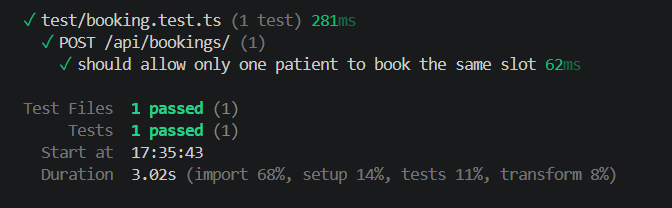

# Appointment Booking System
A doctor appointment booking system that allows patients to view their bookings record, view doctor availability and book consultations, while receptionists can view doctors' schedules and manage doctor leave periods.

# Feature
## Patient
- Login as a patient
- View booking records
- View doctor available consultation slots and make appointment

## Receptionist
- Login as a receptionist
- View all doctor appointments and leaves
- Create leave for doctor

# Tech Stack
## Frontend
- Vue 3
- Vuetify

## Backend
- Node.js
- Express
- MySQL
- Sequelize ORM

# Prerequisites and version
- Node.js: ^22.18.0
- MySQL: 8.0.46

# Installation
Clone the repository from Github
```
git clone https://github.com/SeowKarYan/booking-system.git
```

## Frontend
### Install frontend dependencies
Run *cd frontend* command to change the directory into frontend directory.

Run *npm install* command to install the dependencies, it will generate `node_modules` folder under frontend directory
```
cd frontend
npm install
```
### Build frontend
Inside frontend directory, run *npm run build* command to build the project, it will generate `dist` folder
```
npm run build
``` 

## Backend
If you are still in frontend directory run *cd ../* to change the directory into booking-system project directory

```
cd ../
```

### Install backend dependencies
Run *cd backend* command to change the directory into backend directory.

Run *npm install* command to install the dependencies, it will generate `node_modules` folder under backend directory
```
cd backend
npm install
```

### Create `.env` file
Create `.env` file in the backend directory, put in your MySQL password in DB_PASSWORD
```
# DATABASE
DB_NAME=booking_system
DB_USERNAME=root
DB_PASSWORD=
DB_HOST=localhost
DB_PORT=3306

# JWT
JWT_SECRET=07092ecbd13cba32044d44639e9ea08dc3ca71a0e1a4337d5136f79a905741e6

# ENVIRONMENT
NODE_ENV=development
PORT=5000
FRONTEND_URL=http://localhost:5173
```

# Database Setup
## Create Database
In backend directory, run *npm run db:create* command to create the database
```
npm run db:create
```

## Migration
In backend directory, run *npm run db:migrate* command to create all the tables and columns in database
```
npm run db:migrate
```

## Seeder
In backend directory, run *npm run db:seed* command to create data
```
npm run db:seed
```

If you want to undo the seeder, you can run *npm run db:seed:undo* command to delete all the data
```
npm run db:seed:undo
```

# Running the Application
Inside the backend directory, run *npm run start* command to start the application, open `http://localhost:5000` in browser

```
npm run start
```

# Running in development mode
Everytime change the code, it will restart and update
## Frontend
Inside frontend directory, run *npm run dev* command
```
cd frontend
npm run dev
```
## Backend
Inside backend directory, run *npm run dev* command
```
cd backend
npm run dev
```

# Running Test Code
Inside the backend directory, run *npm run test:run* command to run the backend test code.
```
npm run test:run
```
1 test will run, it will test when 2 patients booking same slot at the same time, only one booking will be created.

Test Result: 



# Login Account
All the account generate by seeder will using `password` as password. These 2 accounts are the hardcoded account.
| Role | Email | Password |
|---|---|---|
| Patient | patient@test.com | password
| Receptionist | reception@test.com | password

# Design Considerations
## Preventing Double Booking
The application uses database-level constraints with a unique index to prevent two requests from successfully booking the same doctor and time slot.

## Render Slot with Reusable Component
Calendar component is used in patient and receptionist page. It has a events props, in different view will render different event in calendar.

| Role | Page | Events Props |
|---|---|---|
| Patient | Make Appointment | Available Slot
| Patient | My Bookings | Booking Record
| Receptionist | Doctor Schedule | Booking Record and Doctor Leave